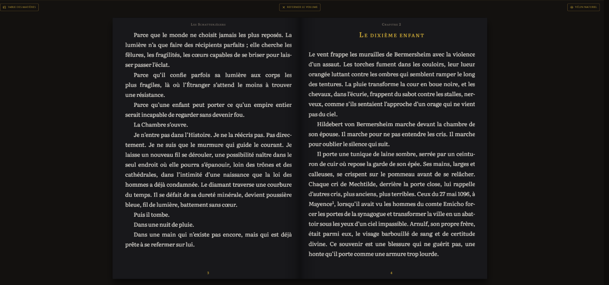
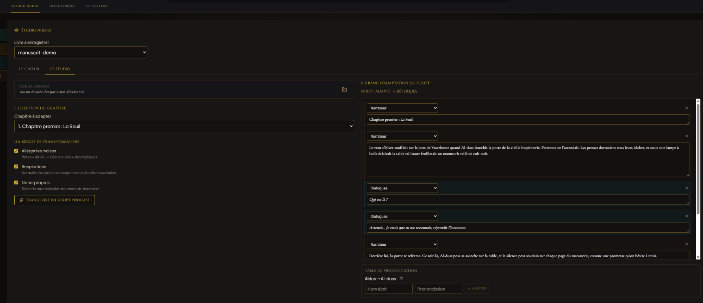

# ❦ ALDUS : Atelier du Livre Moderne


> *« Festina Lente »* — Hâte-toi lentement.

**Aldus** est un environnement d'artisanat littéraire et d'ingénierie éditoriale conçu pour les
écrivains indépendants et les typographes exigeants. Inspiré par les maîtres imprimeurs de la
Renaissance vénitienne, il unifie la rigueur millimétrique des normes Amazon KDP et l'élégance de
la typographie humaniste.

---

## ✦ Fonctionnalités Majeures

- **Ambiance Dark Atelier :** une interface feutrée d'ébène, d'or et de cuir, conçue pour éliminer
  la fatigue visuelle et honorer la noblesse du texte.
- **Creuset Typographique :** fonderie de caractères en or liquide, symbolisant l'acte premier de
  la composition du livre.
- **Réglette & Calibreur de Dos KDP :** calcul dynamique de l'épaisseur du dos (papier blanc, crème
  ou couleur) et génération du gabarit de couverture complet avec marges de fond perdu (3,2 mm).
- **Banc III — L'Écritoire :** sélection de chapitres Markdown existants ou création de nouveaux
  fichiers `.md` dans le dossier source du projet, avec sauvegarde automatique.
- **Banc IV — Bibliothèque :** rayons de livres, scan et regroupement EPUB/PDF/DOCX, statistiques
  par format, gestion des exports et badge AUDIO sur les ouvrages narrés.
- **Lecteur d'Atelier :** « Ouvrir le livre » lit l'EPUB, le PDF ou le DOCX en plein écran dans
  Aldus : trois papiers (Vélin, Parchemin, Dark Atelier), tiroir typographique, mode Silence après
  3 s, table des matières interactive et signets dorés persistants.
- **Banc V — Studio Audio (ruban dédié) :** console du moteur XTTS v2 local, choix de la voix,
  table de synthèse par chapitre (génération incrémentale, progression, écoute, suppression des
  MP3); le manuscrit reste sur la machine.
- **Diptyque d'écriture :** éditeur Markdown épuré sur le feuillet gauche et prévisualisation
  typographique instantanée sur le feuillet droit, selon les réglages du manuscrit.
- **Réglet & Manuel du Scribe :** insertion rapide de guillemets français (`« »`), espaces
  insécables, cadratins (`—`), apostrophes courbes (`’`) et ligatures (`œ/Œ`) ; aide intégrée pour
  les titres, dialogues, exergues, notes de bas de page et séparateurs de scène.
- **Correcteur Humaniste :** traitement conforme au *Code typographique* et au *Lexique des règles
  typographiques en usage à l'Imprimerie nationale* (espaces insécables et fines insécables, tirets
  cadratins, apostrophes courbes, ligatures `œ`/`æ`, majuscules accentuées, gloses marginales).
- **Le Pressoir Final :** tirage cérémoniel en trois temps (encrage, serrage, massicotage) et export
  vers les formes d'édition validées — PDF d'impression prêt-à-imprimer (gabarit KDP), ePub 3
  reflowable, gabarit de jaquette.

---

## ✨ Nouveautés de la version 1.4.12 — Salon de lecture & Oratoire

- **Oratoire :** manuscrit transcrit en script de podcast (Narrateur / Dialogues, incises élaguées,
  respirations, table phonétique), synthèse locale sur `127.0.0.1:8020`, assemblage FFmpeg,
  Discothèque et console à bande aux vu-mètres réactifs. Voir le [guide de l'Oratoire](docs/guide-oratoire.md).
- **Salon de lecture :** double page permanente, tournage de page 3D, curseur « Chapitre X · Page Y »,
  césures françaises et lettrines, papiers Atelier Sombre et Vélin Naturel ; les PDF y sont recomposés.
  Voir le [guide du Salon](docs/guide-salon-de-lecture.md).




---

## ✨ Nouveautés de la version 1.4.0 — Bibliothèque & Studio Audio

- **Banc IV — Bibliothèque :** scan des exports, regroupement des formats, statistiques, rayons
  personnalisés et suppression confirmée qui préserve les sources partagées.
- **Banc V — Studio Audio :** wrapper XTTS v2 local sur `127.0.0.1:8020`, voix françaises,
  assistant de mise en route et lecteur par chapitre.
- **Forge ciblée :** choisissez un chapitre ou toute l'œuvre; les nouvelles pistes sont fusionnées
  dans `library.json` sans effacer celles des autres chapitres.
- **Longs chapitres :** segmentation sous 240 caractères, synthèse séquentielle, assemblage MP3
  et progression du chapitre/segment dans le pupitre supérieur.
- **Journalisation :** erreurs HTTP, timeout, arrêt du wrapper et échecs d'inférence détaillés.

Consultez le [Manuel du Scribe Audio](docs/manuel-scribe-audio.md) pour installer et vérifier le
moteur local.

## ✨ Nouveautés de la version 1.3.0 — Banc III : L'Écritoire

- **Studio d'écriture Markdown natif :** création et sélection précise de chapitres `.md`
  directement dans le dossier source du projet, avec sauvegarde automatique.
- **Diptyque de rédaction :** éditeur Markdown épuré aux tons ébène et or de la charte *Dark Atelier*
  sur le feuillet gauche ; prévisualisation typographique en temps réel sur le feuillet droit.
- **Réglet typographique :** insertion au curseur des guillemets français (`« »`), espaces
  insécables, tirets cadratins (`—`), apostrophes courbes (`’`) et ligatures (`œ/Œ`).
- **Manuel du Scribe :** aide intégrée à la syntaxe Markdown romanesque, avec exemples de titres,
  dialogues, exergues, notes de bas de page et séparateurs de scène.

---

## 📥 Téléchargements & Installation (v1.4.0)

Téléchargez Aldus depuis la [Release GitHub v1.4.0](https://github.com/danoe78210/aldus/releases/tag/v1.4.0) :

- **Windows (64 bits) :** installateur `.exe` ou paquet `.msi` dans les assets de la release.
- **macOS (Intel et Apple Silicon) :** image disque universelle `.dmg` dans les assets de la release.
- **Linux (amd64) :** `.AppImage`, paquet Debian/Ubuntu `.deb` et paquet Fedora/RHEL `.rpm` dans les assets de la release.

Les empreintes SHA-256 de chaque fichier sont affichées dans la page des Releases.

---

## ✦ Stack Technique

- **Moteur :** [Tauri v2](https://tauri.app/) (Rust) — moteurs Typst (PDF), `docx-rs`, `epub-builder`
- **Interface :** React, TypeScript, Vite
- **Styles :** Tailwind CSS v4
- **Typographie :** glyphes et tracés vectoriels SVG d'artisanat

---

## ✦ Installation & Compilation

### Prérequis
- [Node.js](https://nodejs.org/) (version 20 ou supérieure)
- [Rust & Cargo](https://rustup.rs/) (version 1.75 ou supérieure)

### Démarrage en mode développement

```bash
npm install
npm run tauri dev
```

### Compilation de production locale

```bash
npm run build
npm run tauri build
```

---

## ✦ Documentation

- `specifications_fonctionnelles.md` — référence produit (identité, parcours, recette).
- `specifications_techniques.md` — référence d'implémentation (stack, charte, composants).
- `docs/manuel-scribe-audio.md` — mise en route du wrapper XTTS v2 local, sélection de chapitre et diagnostic audio.
- `SPECIFICATIONS_COVER_STUDIO_v1.2.0.md` — atelier de reliure & marbre de montage.
- `specifications_roman_kdp.md` — cahier des charges fonctionnel KDP.
- `archive/` — documents v0, conservés pour traçabilité.

### Contrôles de validation

```bash
npx tsc --noEmit -p tsconfig.app.json
npm run build
cargo check --manifest-path src-tauri/Cargo.toml
```

---

## ✦ Licence

Ce projet est distribué sous licence MIT. Consultez le fichier `LICENSE` pour plus de détails.